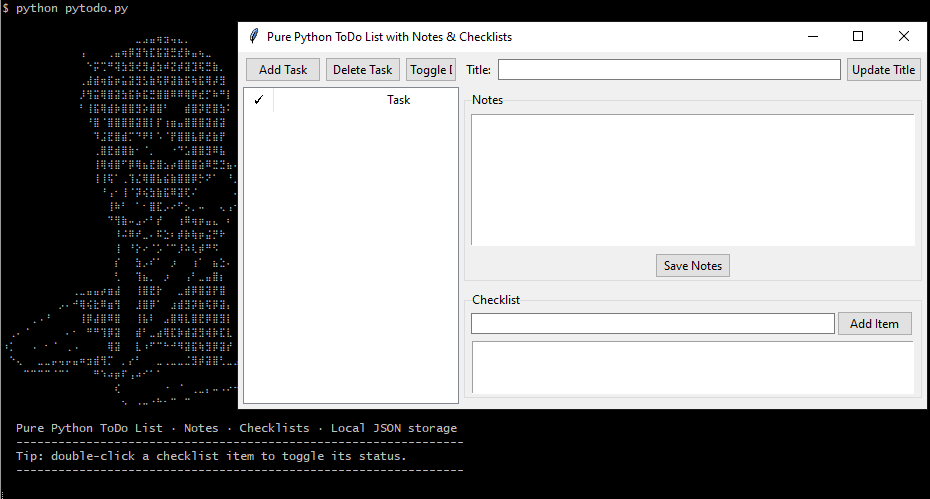

<div align="center">

# ⠀ Okami PyToDo

<p>
  
</p>

**A minimalist ToDo list with notes and checklists — built with pure Python.**

[](https://www.python.org/)
[](https://github.com/OkamiCoder/)
[](LICENSE)
[](https://docs.python.org/3/library/tkinter.html)

*Zero third-party libraries. Zero `pip install`. Just Python.*

</div>

---

## 🖼️ Banner

```text
⠀⠀⠀⠀⠀⠀⠀⠀⠀⠀⠀⠀⠀⠀⠀⠀⠀⠀⠀⣀⣠⣤⢶⣲⢤⣄⡀⠀⠀⠀⠀⠀⠀⠀⠀⠀⠀⠀⠀⠀⠀⠀⠀⠀⠀⠀⠀⠀
⠀⠀⠀⠀⠀⠀⠀⠀⠀⠀⠀⢠⠀⠀⠀⢀⣤⢶⡿⣽⢳⣏⣯⣽⣛⣞⡷⣤⢦⣀⠀⠀⠀⠀⠀⠀⠀⠀⠀⠀⠀⠀⠀⠀⠀⠀⠀⠀
⠀⠀⠀⠀⠀⠀⠀⠀⠀⠀⠀⠀⠑⡭⢉⠛⢽⣳⣻⢞⣻⣼⣳⠾⣝⡾⣽⣹⢯⣛⣷⡀⠀⠀⠀⠀⠀⠀⠀⠀⠀⠀⠀⠀⠀⠀⠀⠀
⠀⠀⠀⠀⠀⠀⠀⠀⠀⠀⠀⢀⣼⣾⢶⣯⡶⣥⣽⣻⣣⣷⢯⡿⣽⣷⣯⢷⣯⢿⡼⣻⠀⠀⠀⠀⠀⠀⠀⠀⠀⠀⠀⠀⠀⠀⠀⠀
⠀⠀⠀⠀⠀⠀⠀⠀⠀⠀⠀⡸⢻⣭⢿⣿⣽⣳⣯⡷⣯⣛⣿⣿⠿⠿⢿⡿⣞⡋⠷⠛⡇⠀⠀⠀⠀⠀⠀⠀⠀⠀⠀⠀⠀⠀⠀⠀
⠀⠀⠀⠀⠀⠀⠀⠀⠀⠀⠀⠃⢸⣯⢿⣾⡷⣿⣿⣻⡵⣿⣿⠃⠀⠀⣾⣿⡽⣟⣿⣳⠅⠀⠀⠀⠀⠀⠀⠀⠀⠀⠀⠀⠀⠀⠀⠀
⠀⠀⠀⠀⠀⠀⠀⠀⠀⠀⠀⠀⠘⣿⠈⣿⣿⣿⣿⣽⣿⡇⡏⢰⣶⣤⣿⣿⣿⣽⣾⣽⠀⠀⠀⠀⠀⠀⠀⠀⠀⠀⠀⠀⠀⠀⠀⠀
⠀⠀⠀⠀⠀⠀⠀⠀⠀⠀⠀⠀⠀⠹⣨⣟⣿⣾⡉⠙⠟⠇⠡⠈⡟⣿⣿⣧⡿⣞⣷⡟⠀⠀⠀⠀⠀⠀⠀⠀⠀⠀⠀⠀⠀⠀⠀⠀
⠀⠀⠀⠀⠀⠀⠀⠀⠀⠀⠀⠀⠀⢀⣿⣟⣾⣿⣷⠂⠈⡀⠀⠀⠐⠙⣡⣿⣿⣻⠿⣧⠀⠀⠀⠀⠀⠀⠀⠀⠀⠀⠀⠀⠀⠀⠀⠀
⠀⠀⠀⠀⠀⠀⠀⠀⠀⠀⠀⠀⠀⢸⢿⢾⣿⠋⡿⢿⣦⣟⣿⣢⡴⣿⣿⣿⣵⠿⣛⣙⣦⠄⠀⠀⠀⠀⠀⠀⠀⠀⠀⠀⠀⠀⠀⠀
⠀⠀⠀⠀⠀⠀⠀⠀⠀⠀⠀⠀⠀⢸⢸⢯⠁⢀⢹⣌⢿⣿⣧⣮⣷⣿⣿⡿⡓⠝⠁⠀⠘⡀⠀⠀⠀⠀⠀⠀⠀⠀⠀⠀⠀⠀⠀⠀
⠀⠀⠀⠀⠀⠀⠀⠀⠀⠀⠀⠀⠀⠀⠘⢠⠂⢸⠈⡽⢮⣳⣷⣯⠿⣽⢏⠌⠀⠀⠀⠀⠀⠄⠀⠀⠀⠀⠀⠀⠀⠀⠀⠀⠀⠀⠀⠀
⠀⠀⠀⠀⠀⠀⠀⠀⠀⠀⠀⠀⠀⠀⠀⢸⠷⠃⠀⠁⠂⣿⣏⡠⠔⠋⡢⡀⠤⠀⠀⢄⢠⠂⠀⠀⠀⠀⠀⠀⠀⠀⠀⠀⠀⠀⠀⠀
⠀⠀⠀⠀⠀⠀⠀⠀⠀⠀⠀⠀⠀⠀⠀⠙⢻⣷⠤⣠⠔⠃⡞⠀⠀⢰⠿⢶⡶⣤⣄⠀⠆⠀⠀⠀⠀⠀⠀⠀⠀⠀⠀⠀⠀⠀⠀⠀
⠀⠀⠀⠀⠀⠀⠀⠀⠀⠀⠀⠀⠀⠀⠀⠀⠸⠬⠿⠞⣀⠄⠯⣑⠆⡾⡷⢷⡶⣬⡛⠗⠀⠀⠀⠀⠀⠀⠀⠀⠀⠀⠀⠀⠀⠀⠀⠀
⠀⠀⠀⠀⠀⠀⠀⠀⠀⠀⠀⠀⠀⠀⠀⠀⢸⠀⠘⡕⠔⠈⡡⠈⠉⡸⠵⢇⡾⠛⠫⠀⠀⠀⠀⠀⠀⠀⠀⠀⠀⠀⠀⠀⠀⠀⠀⠀
⠀⠀⠀⠀⠀⠀⠀⠀⠀⠀⠀⠀⠀⠀⠀⠀⡎⠀⠀⣳⡠⠎⠁⠀⡰⠀⠀⢰⠁⠀⣦⣑⠄⠀⠀⠀⠀⠀⠀⠀⠀⠀⠀⠀⠀⠀⠀⠀
⠀⠀⠀⠀⠀⠀⠀⠀⠀⠀⠀⠀⠀⠀⠀⠀⢃⠀⠀⢹⣦⡀⠀⡰⠀⠀⢠⠃⣀⣤⣿⡆⠀⠀⠀⠀⠀⠀⠀⠀⠀⠀⠀⠀⠀⠀⠀⠀
⠀⠀⠀⠀⠀⠀⠀⠀⠀⠀⢀⣀⣤⣤⡴⣶⣼⠀⠀⢸⣿⣟⡗⠀⠀⣀⣾⡿⣿⣽⡟⣿⠀⠀⠀⠀⠀⠀⠀⠀⠀⠀⠀⠀⠀⠀⠀⠀
⠀⠀⠀⠀⠀⠀⠀⠀⡠⠄⠚⢿⢮⣗⠿⣶⢻⠀⠀⣸⣿⡿⠁⠀⣰⣾⣻⡽⣷⢯⡿⣽⡄⠀⠀⠀⠀⠀⠀⠀⠀⠀⠀⠀⠀⠀⠀⠀
⠀⠀⠀⠀⢀⠠⠘⠀⠀⠀⠀⢸⡿⣼⣿⠿⣿⠀⠀⢸⣧⠇⠀⣠⣿⢿⣇⣿⣟⡿⣿⣻⡇⠀⠀⠀⠀⠀⠀⠀⠀⠀⠀⠀⠀⠀⠀⠀
⠀⢀⠄⠈⠀⠀⠀⠀⠀⠄⠂⠀⠛⠛⢹⡿⣽⠀⠀⣾⠃⣀⣴⢿⣏⡷⣾⣽⣻⢾⡷⣏⣇⠀⠀⠀⠀⠀⠀⠀⠀⠀⠀⠀⠀⠀⠀⠀
⠰⡁⠀⠀⠠⠀⠂⠈⠀⢀⠠⠀⠀⠀⠀⢿⣽⠀⠀⣇⠰⠋⠉⠓⠚⠻⣽⣯⢷⣻⡿⣽⡞⠀⠀⠀⠀⠀⠀⠀⠀⠀⠀⠀⠀⠀⠀⠀
⠀⠑⢄⠀⠀⣀⣀⡤⢤⡤⣤⠶⣲⣾⢻⡉⠀⡀⡔⠃⠀⠀⣀⢀⣀⣀⣈⣻⡾⣽⣿⢃⣀⣠⠀⠀⠀⡶⢿⣿⣿⣿⣷⣤⣄⡀⠀⠀
⠀⠀⠀⠉⠉⠉⠉⠈⠉⠁⠀⠀⠀⠛⠱⠴⡶⠏⢠⠴⠊⠁⠁⠀⠀⠀⠀⠀⠀⠀⠀⠀⠀⠀⠐⡄⠀⢸⢰⣾⣿⣿⣿⣿⣿⣿⣦⡀
⠀⠀⠀⠀⠀⠀⠀⠀⠀⠀⠀⠀⠀⠀⠀⠀⢎⠀⠀⠀⠀⠀⠀⠐⠀⠈⠀⢀⣀⡄⠤⠠⠔⠒⠻⠁⠒⠚⠊⠛⠛⠻⢿⣿⣿⣿⣿⡇
⠀⠀⠀⠀⠀⠀⠀⠀⠀⠀⠀⠀⠀⠀⠀⠀⠀⠢⠀⠠⠤⠐⠓⠂⠉⠀⠉⠀⠀⠀⠀⠀⠀⠀⠀⠀⠀⠀⠀⠀⠀⠀⠀⠈⠉⠉⠉⠀
```

---

## 📖 About

**Okami ToDo** is a lightweight desktop task manager written in **pure Python** — no third-party libraries, no virtual environments required, no `pip install` steps. It uses only the standard library (`tkinter`, `json`, `uuid`, `os`) and stores all data locally in a single `tasks.json` file, so it works fully offline and keeps your data private.

The app was built as a demonstration that a genuinely useful, feature-complete desktop application can be written in under 300 lines of clean Python — a nice fit for a personal portfolio or a teaching example.

---

## ✨ Features

- ✅ **Tasks with rich details** - every task has a title, free-form notes, and its own checklist.
- 📝 **Notes per task** - a dedicated multi-line text area for additional context, ideas, or documentation.
- ☑️ **Per-task checklists** - add, remove, and toggle sub-items; double-click an item to mark it done.
- 💾 **Local JSON storage** - everything is saved to `tasks.json` next to the script; no database, no cloud.
- 🔒 **Atomic saves** - writes go through a temporary file and `os.replace` to prevent data corruption on crashes.
- 🐍 **Zero dependencies** - only the Python standard library. Truly portable.
- 🖥️ **Cross-platform GUI** - works on Windows, macOS, and Linux thanks to Tkinter.
- 🎨 **ASCII-art welcome banner** — because a CLI-first impression is cool.

---

## 📦 Requirements

- **Python 3.8 or newer**
- **Tkinter** - bundled with the official Python installer on Windows and macOS. On some Linux distros, it may ship as a separate package:

```bash
# Debian / Ubuntu
sudo apt install python3-tk

# Fedora
sudo dnf install python3-tkinter

# Arch Linux
sudo pacman -S tk
```

That's it. No `requirements.txt`, no `pip`, no setup.

---

## 🚀 Getting Started

### 1. Clone the repository

```bash
git clone https://github.com/OkamiCoder/<repo-name>.git
cd <repo-name>
```

### 2. Run

```bash
python todo_app.py
```

That's literally it. On first launch, the ASCII-art banner is printed to the console, then the GUI window opens with an empty task list. A `tasks.json` file will be created automatically as soon as you add your first task.

---

## 🕹️ Usage

| Action | How |
|---|---|
| **Add a task** | Click **Add Task** → enter a title. |
| **Select a task** | Click its row in the left-hand list. |
| **Edit a title** | Change the title field and click **Update Title**. |
| **Write notes** | Fill the notes box and click **Save Notes**. |
| **Add a checklist item** | Type in the field under *Checklist* and press `Enter` (or click **Add Item**). |
| **Toggle a checklist item** | **Double-click** the item in the list. |
| **Remove a checklist item** | Select it and click **Remove Selected Item**. |
| **Mark a whole task as done** | Click **Toggle Done**. |
| **Delete a task** | Select it and click **Delete Task**. |

All changes are auto-saved to `tasks.json` the moment they occur.

---

## 🗂️ Data Format

Your data lives in `tasks.json` and looks like this:

```json
[
  {
    "id": "0f6c0f8a-3b1e-4a10-9e3a-8d6c7f0c1234",
    "title": "Write README for the project",
    "notes": "Cover features, usage and roadmap.",
    "checklist": [
      { "text": "Add banner", "done": true },
      { "text": "Add usage table", "done": false },
      { "text": "Add roadmap", "done": false }
    ],
    "completed": false
  }
]
```

Because it's plain JSON, you can back it up, edit it, diff it in Git, or migrate it anywhere.

---

## 📁 Project Structure

```
.
├── todo_app.py     # The entire application — one self-contained file
├── tasks.json      # Auto-created on first save; your data lives here
├── README.md       # This file
└── LICENSE         # MIT
```

---

## 🗺️ Roadmap

Ideas for future iterations (all still achievable with the standard library):

- [ ] Search / filter tasks by text or completion status
- [ ] Task priorities and color-coded tags
- [ ] Due dates with a calendar picker
- [ ] Drag-and-drop task reordering
- [ ] Export task list to Markdown or plain text
- [ ] Optional dark theme via Tkinter ttk styles
- [ ] Migrate storage from JSON to SQLite (`sqlite3` — still stdlib!)

---

## 🤝 Contributing

Contributions, issues, and feature requests are welcome. Feel free to fork the repo, open an issue, or submit a pull request.

1. Fork the project.
2. Create your branch: `git checkout -b feature/my-feature`.
3. Commit your changes: `git commit -m "Add my feature"`.
4. Push to the branch: `git push origin feature/my-feature`.
5. Open a Pull Request.

---

## 📜 License

Distributed under the **MIT License**. See [`LICENSE`](LICENSE) for more information.

---

## 👤 Author

**OkamiCoder**

- GitHub: [@OkamiCoder](https://github.com/OkamiCoder/)

---

<div align="center">

*Made with 🐺 and the Python standard library.*

</div>
